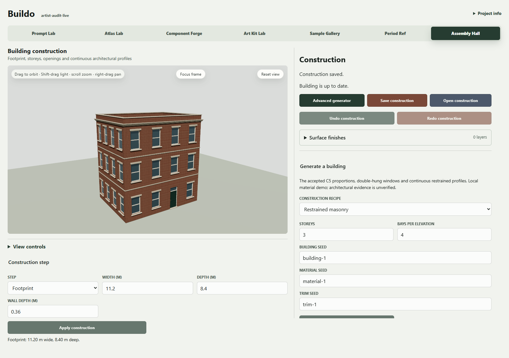
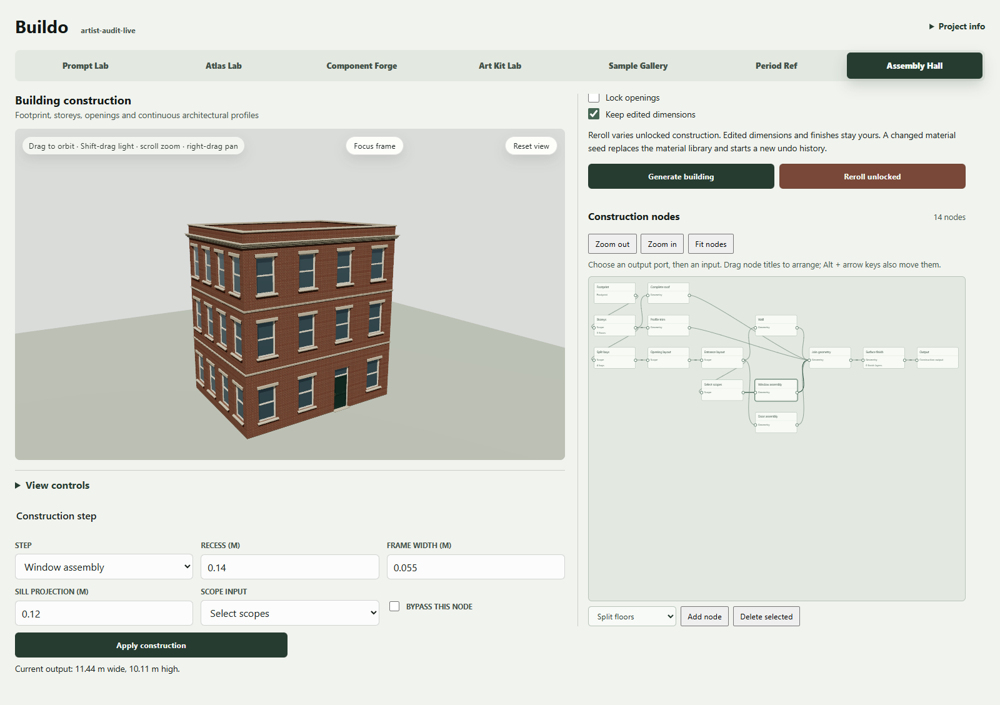
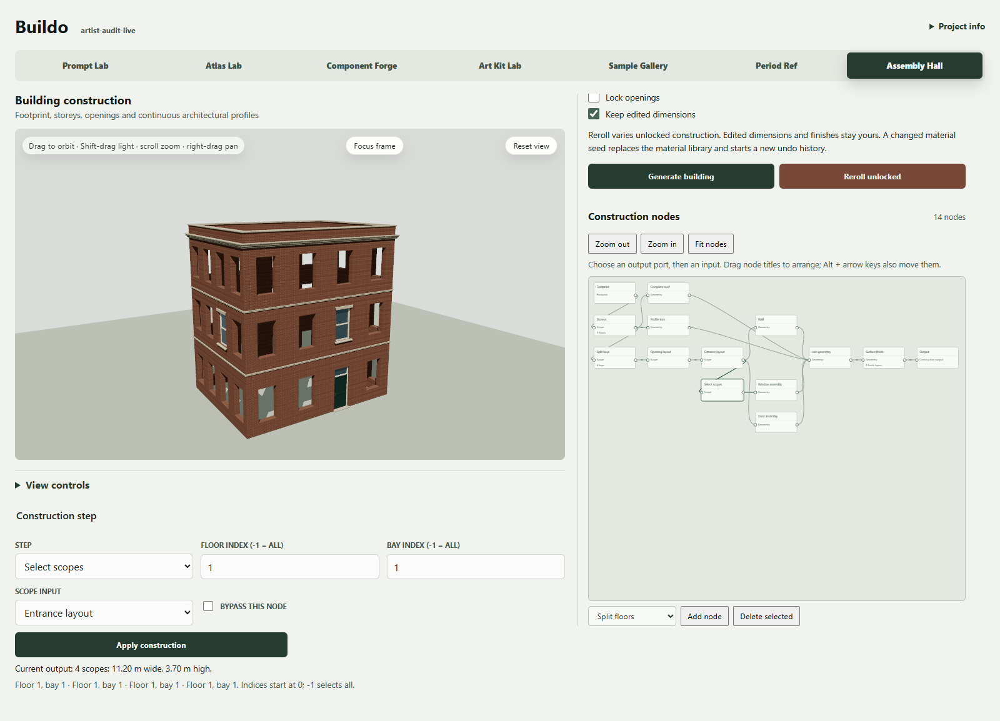
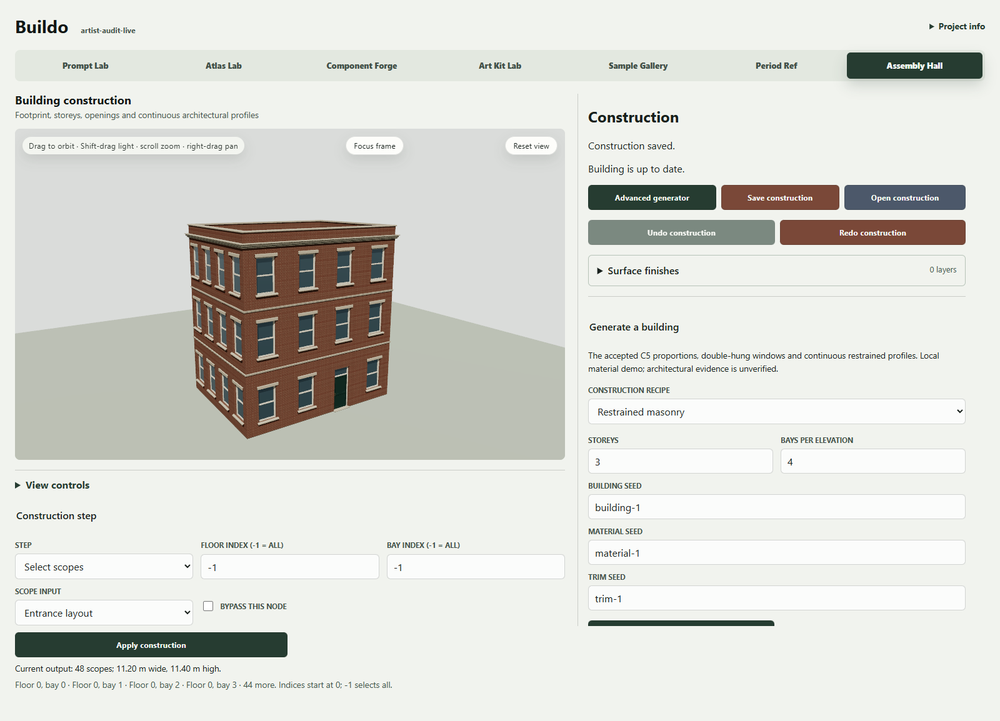
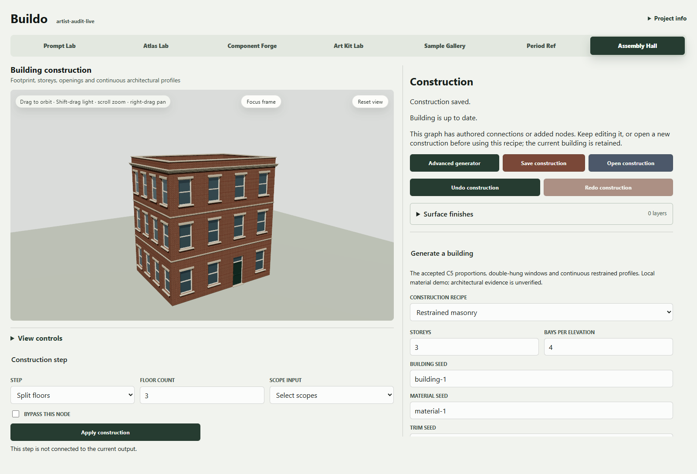
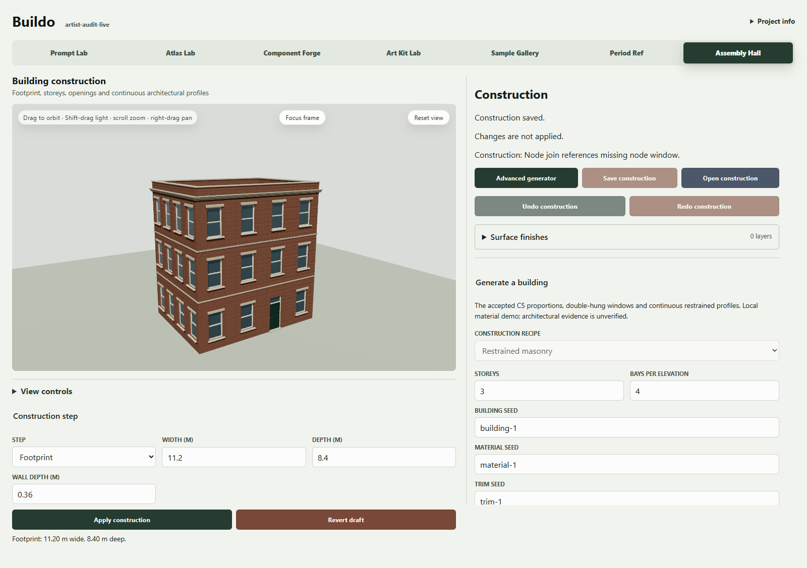
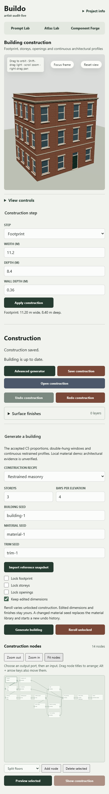

# Artist authoring: graph engine, artist-facing workflow

The user supports the direction and quality but raised audience complexity as a product concern on 2026-10-18. This review evaluates the current authoring model before further assembly expansion. It does not replace or rewrite the graph engine, and it does not infer unconditional C6 visual acceptance.

**Recommendation:** test recipe controls plus viewport selection and a constrained construction stack as the main artist workflow. Retain the editable node graph in an explicit advanced recipe-authoring workspace. This is a design recommendation, not a validated usability result or an implemented interface.

[Phone gallery: all eight walkthrough images and the alternatives](https://app.notion.com/p/3fdb77d6cd4f812a9f88f1316beb9c25). All 77 previous C4/C5/C6 image blocks are retained; requested Buildo parent placement remains unresolved.

## Evidence and limits

Seven probes ran against the real compiler and generation resolver in this audit. All 62 C6 source pins remain unchanged. No production code or existing review packet changed. [Receipt](verification.json), [literal probe results](core-probes.json), and [reproducible script](stress-core.mjs.txt).

After two in-app-browser timeouts, the user approved the existing Playwright/Chromium workflow. The fresh real-App walkthrough captured eight states and seventeen actions on WebGPU, with zero browser errors; each saved screenshot was inspected before proceeding. All 62 C6 source pins were checked before and after. Both audit-only servers were closed. This is a single-agent code/behavior and browser walkthrough, not the formal independent Impeccable critique, an observed human test or a complete accessibility audit. No prior screenshots are substituted as audit evidence.

## Current task stress cases

| Artist goal | Current path and evidence | Consequence |
|---|---|---|
| Change a whole building's dimensions or recipe | Named generation controls and the construction-step inspector already drive the graph. Window frame width changed the shared prototype while retaining 47 window instances in the core probe. | Much ordinary editing already has a path without touching wires. Expose that path deliberately and clarify global scope. |
| Change just one window's geometry | Viewport selection resolves frame/glass to a frame for finish authoring. The window assembly parameters belong to the shared assembly node. There is no scoped structural override exposed by this workflow. | Clicking a window must not imply that editing shared geometry fields changes only that window. This needs a real targeted operation, not merely a simpler label. |
| Select floor 2, bay 2 to work on it | Setting SelectScopes floorIndex=1/bayIndex=1 changes generated windows from 47 to 4, one per elevation. The wall-opening branch is independent. | The operator filters construction output; it is not a viewport edit selection. The two meanings of selection are a major audience risk. |
| Add a construction operation | Adding an unconnected SplitFloors node compiles with the same geometry, and it is absent from the evaluated trace. The same extra node causes recipe reroll to reject custom topology. | An edit can have no visible effect while changing which workflows remain available. The UI does report that the step is not connected to the output. Explain the regeneration boundary before committing advanced topology changes, and preserve a clear path back to supported recipe controls. |
| Remove windows | Deleting the referenced window assembly is rejected because the join still references it. The UI deletion handler removes the node, not its downstream links. | A generic delete action requires graph repair knowledge; an artist-facing remove operation should produce a valid bounded command or explain dependencies before commit. |
| Hide or restore the roof | Bypassing the roof changes real geometry and bounds. | A labeled Roof enabled control or construction-stack visibility control can expose the same valid operation without wires. |
| Enter an impossible opening width | Width 8 m is rejected with an actionable masonry-clearance diagnostic. Existing publication retains the prior accepted scene. | Keep this validation and last-good-scene behavior under any alternative interface. Make field ownership and recovery visible. |

Source seams: `ConstructionNodePanel.tsx` owns wiring/add/delete/layout; `BayConstructionWorkbench.tsx` owns selected-node fields, draft/apply/revert and publication; `ConstructionSurfacePanel.tsx` owns selected/all frame finish layers; `constructionGenerationState.ts` preserves numeric edits and rejects custom topology during recipe replacement. The generic operator picker exposes 17 types while the initial building has 14 nodes; legacy facade and whole-building operations share the menu. This is a code observation, not a measured first-time-user score.

## Live walkthrough and priority findings

1. **Initial workspace:** the building remains visible and ordinary dimensions have labeled inputs. Generation controls and step properties split related choices across separate areas. This is a workable base for an artist inspector.

2. **Fit the graph:** fourteen nodes fit into a sidebar, but labels and ports become very small. The seventeen-type add menu exposes both legacy facade and whole-building concepts. **P2:** give advanced authoring enough space and organize relevant operators.

3. **Choose Window assembly:** shared recess/frame/sill fields appear alongside Scope input and Bypass. **P1:** the inspector does not make the global-versus-local effect explicit enough for a user who has clicked a window. Targeted geometry changes still need an actual scoped command.

4. **Set floor/bay selection:** frame instances fall from 47 to 4 and the other wall openings remain empty. There is no validation error because this is valid generation filtering. **P1:** separate object selection from generation filtering in the artist workspace.

5. **Undo:** the exact prior graph hash and 47 window instances return. This recovery path is a strength to preserve.

6. **Add an unconnected node, apply, then reroll:** the building stays the same and the inspector says the step is not connected. Reroll then rejects the custom graph while retaining the accepted scene. **P1:** make the custom-logic boundary visible before the transition rather than requiring users to discover it through a later action.

7. **Delete a referenced assembly:** applying the draft produces a missing-node diagnostic. The old building stays visible; saving and history traversal are disabled until the invalid draft is resolved. Revert draft restores valid source. **P2:** an artist-facing remove command should handle valid dependencies or explain the consequence before deletion.

8. **Compact layout:** labeled ordinary controls reflow into a usable list, but the fitted graph becomes an overview with tiny text and ports. **P2:** avoid making a sidebar graph the required route for ordinary editing. This does not establish touch or mobile-authoring readiness.

Accessibility limits: native inputs/buttons have labels, and source includes keyboard layout support, but this run used mouse/form automation. Fitted node text and port targets are visible size risks. Keyboard-only completion, screen-reader graph navigation, focus visibility, contrast and touch accuracy require separate tests; no compliance score is claimed.

## Alternatives to compare

| Approach | Artist interaction | Benefit | Cost / risk |
|---|---|---|---|
| Recipe + grouped inspector | Pick a recipe; edit Building, Storeys, Openings, Roof, Materials; lock dimensions. | Smallest change, fast generation and global edits. | A wall of promoted controls can still overwhelm; individual architectural exceptions need explicit support. |
| Selection + construction stack (recommended primary candidate) | Select building/elevation/storey/bay/part; choose a named action such as Add cornice, Replace window, Change depth; inspect the affected scope before applying. | Maps actions to visible architectural objects and supports non-destructive edits. | Needs real semantic selection and targeted commands. A branching graph cannot be exposed as an arbitrarily reorderable flat stack without constraints. |
| Elevation / facade grid | Work on a 2D elevation; select rows/cells; repeat or replace openings; see the 3D result. | Strong spatial correspondence for repeated facades and local exceptions. | Adds 2D/3D selection synchronization and conventions for corners, roof and irregular footprints. Better a later optional view than an immediate second editor. |
| Node graph with groups/macros | Enter an advanced workspace, expand assemblies, wire typed operations, promote recipe controls. | Retains procedural authoring power and custom recipes. | Still asks users to understand scopes, dependencies and branching. Grouping alone does not solve the selection or reroll-boundary problem. |

Prompting can propose a recipe and initial values, but it should not become the only editing interface. Precise authored choices and visible target scope must survive generation, reroll and reference refresh.

## Concrete artist flow to test

1. Choose a recipe and generate a building; ordinary dimensions and locks are immediately available.
2. Click an opening. The inspector says Front elevation / Storey 2 / Bay 3 / Window, with a visible target highlight and affected count.
3. Choose This window, This storey, This elevation or All matching windows. Unsupported scopes are absent or explicitly unavailable.
4. Change the recess or replace the window treatment. Show a reversible preview and the affected parts; commit once.
5. Keep a short history of named authored changes. Reroll unlocked defaults without erasing exceptions; show conflicts when a count edit would remove an authored target.
6. Open Advanced recipe graph only to change construction logic. Changes still use the same source document, compiler, materials, history and persistence path.

This flow is proposed. In particular, targeted structural changes, elevation selection, affected-count previews and conflict resolution are not currently complete.

## Preserve the foundation

One authoritative document and validated command path must serve both the artist workspace and the advanced graph. Do not add a parallel hardcoded building generator, flatten a branching graph into a misleading stack, or make simple controls silently discard custom nodes. Keep deterministic semantic seeds, explicit recipe/reference pins, material/geometry independence, undo, offline projects and last-good-scene behavior. Existing numeric parameter edits and finish layers already provide useful seams; arbitrary imported/custom topology needs a clear capability boundary.

Relevant precedents support the separation of procedural internals from everyday controls: [Houdini digital assets promote parameters and viewport handles](https://www.sidefx.com/docs/houdini/assets/asset_ui.html), and [Unreal PCG graph instances override exposed parameters](https://dev.epicgames.com/documentation/unreal-engine/procedural-content-generation-overview?lang=en-US). These are workflow references, not proof that either approach suits Buildo's audience.

## Stress test before choosing the interface

[Task protocol and proposed gates](artist-test-protocol.md) separate missing capability, human comprehension and engineering correctness. Run current supported tasks first, then compare recipe/inspector and selection/stack variants on the same engine. Do not count an automated successful click sequence as evidence of artist usability.
