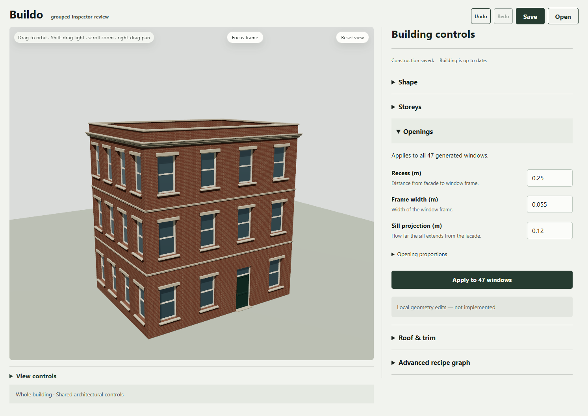
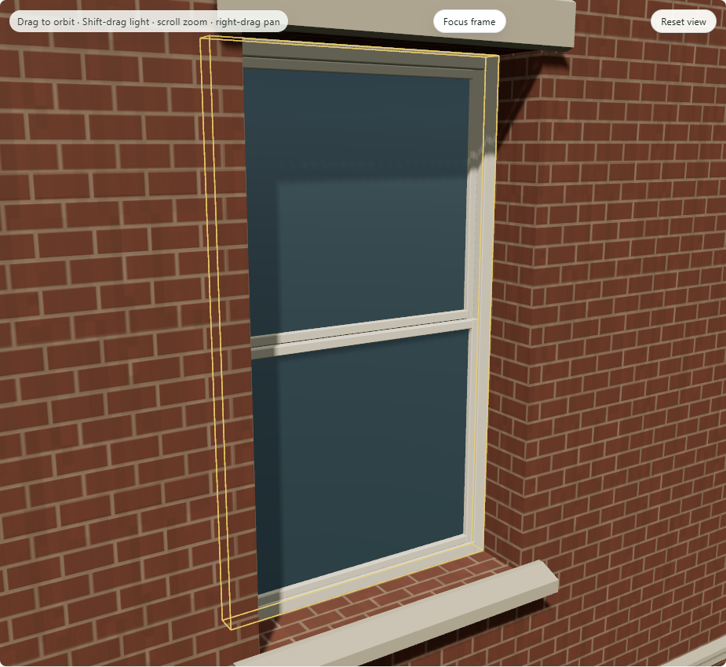
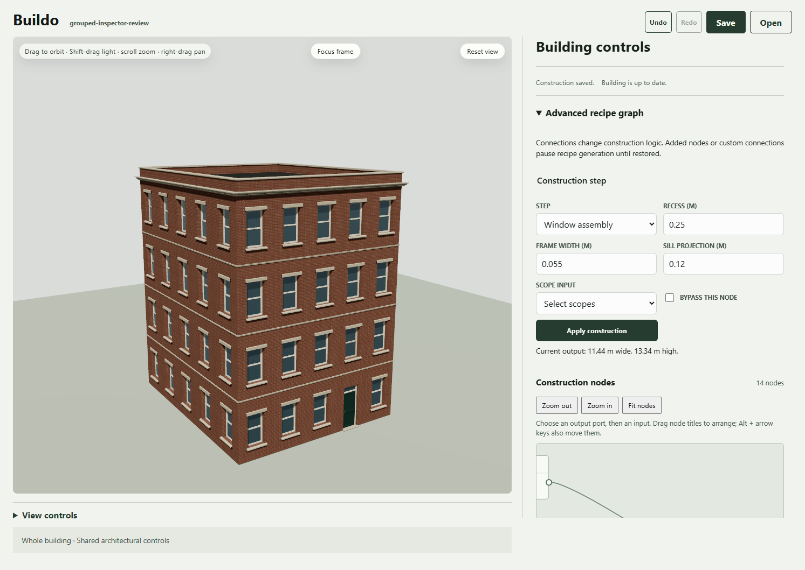
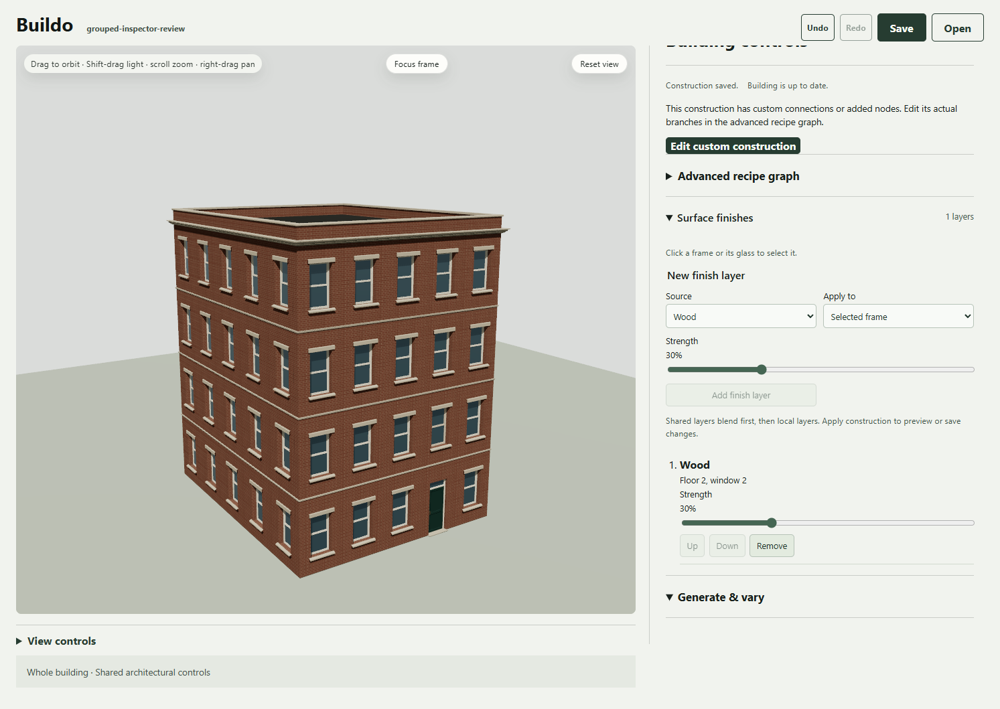
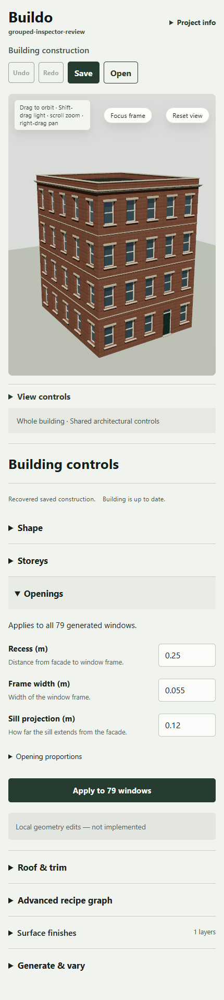

# UX1.P1 - grouped building inspector

Engineering complete; human workflow review pending. The user selected displayed option 1 in the [recorded decision](../2026-10-18-authoring-choice/decision.json). This packet implements that direction on the actual document/compiler/publication path.

Shape, Storeys, Openings and Roof & trim provide shared architectural controls without ordinary node wiring. Openings shows the actual compiled window count and separates shared geometry from local surface finishes. Advanced recipe graph remains available. Added/custom branches safely route to their real graph editor. Generate & vary retains the seeded PSG, recipe, lock and pinned-reference workflow.

All five checks pass: typecheck, lint, **1,753 tests /122 files**, build and **eight standard browser workflows**. Each native backend passes **16 observed states /14 capture events** with zero browser errors. Submitted geometry/transforms match compiler output. Structural edits preserve exact material channels; local finishes preserve geometry. Undo/Redo, legacy C5 files, portable source, numeric-lock reroll, room return and exact cold pixels pass. Cold recovery makes zero provider/material-generation calls. [Verification, exact source pins and check logs](verification.json).

Four existing files changed from the C6 baseline and three were added. The other 58 of62 captured source pins remain literal, including the checked compiler, renderer, material, contracts and persistence seams. Earlier dirty work is preserved. Final checks and both native receipts bind the same 65 source files. No commit, push, release or public publication was performed.

[Visual QA](design-qa.md) passes the selected bounded design, with one inherited nonblocking development favicon 404 recorded separately. Source/implementation comparisons, focus/hover and responsive views are archived. The first native pilot asserted the custom fallback before React's details toggle settled; its screenshot already showed the correct fallback. A visibility wait corrected only the capture driver. The initial standalone focus probe similarly ran before the viewer-enabled control state; all attempts remain recorded. No production change or weakened product assertion was used to close those probes.

## Review images

Both backend folders retain full screenshots, direct native framebuffer PNGs and receipts. Six unique portable JSON sources are deduplicated by content SHA in [portable/manifest.json](portable/manifest.json). Their versions and hashes remain validated by the existing product readers.

## Phone gallery and local preview

[Private Notion review gallery](https://app.notion.com/p/3fdb77d6cd4f812a9f88f1316beb9c25): seven new actual runtime images; all88 previous images retained, **95 total**, with no local image URLs. [Gallery proof](notion-proof.json). The parent Buildo page remains unresolved; no parent was guessed or page moved.

Local preview for this session: `http://127.0.0.1:5190/#document=masonry-study-ux1`. It listens on loopback only; [preview.json](preview.json) records the Node PID and shutdown method. Exec session65060 owns the server. Codex queued its browser tab. This URL is not phone-accessible or a published site; use the Notion images on the phone.

## Boundaries and next decision

Local structural editing remains unimplemented; selecting one frame changes finish scope only. This remains one rectangular construction family with three procedural treatments. Live architectural UTDG coverage is unverified; the pinned material/reference and source lineage path is preserved. Human usability participants: zero. C6 visual review and later family/block/performance gates remain pending.

Review this implemented grouped workflow before admitting another authoring packet. A future scoped structural operation needs its own contract, real target, undo/locks/persistence and rendered success case. The [artist test protocol](../2026-10-18-artist-authoring/artist-test-protocol.md) remains the proposed human evidence path. Passing automated checks does not supply that judgment.
