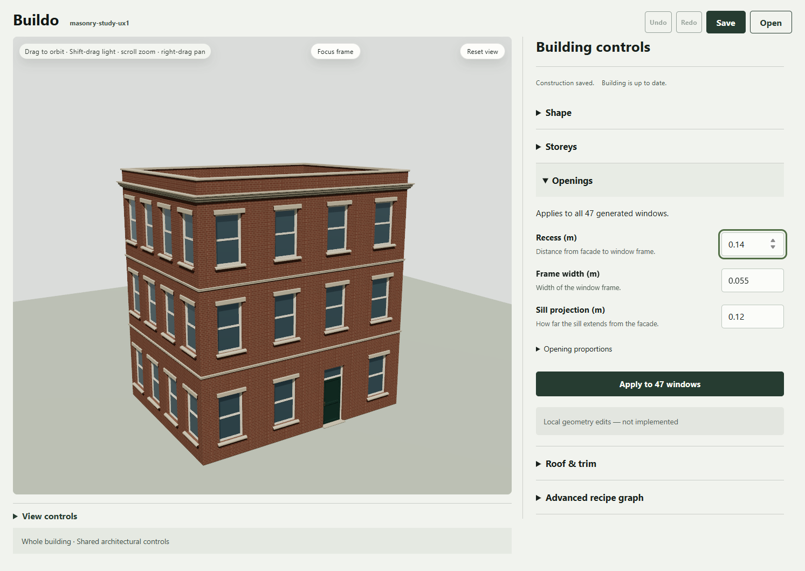

# UX1 local preview recovery - 2026-10-22

The review preview is running again at `http://127.0.0.1:5190/#document=masonry-study-ux1`. The earlier exec handle was gone. A sandbox listener could start but was inaccessible to the outside browser; the exact owned process was verified before it was stopped and replaced with the same loopback-only server outside the sandbox. No installation, product source change, commit, push or publication occurred.

The existing installed Chromium workflow freshly passes actual rendering, visible input focus, keyboard accordion activation, Apply hover and tablet/compact horizontal-overflow checks. The focus screenshot was visually inspected. No application console/page errors were observed; the inherited development favicon404 remains separately recorded. [Receipt and recovery attempts](verification.json). The original broad checks and native geometry proofs remain October18 evidence on byte-identical source, not fresh broad runs.

All65 implementation source pins and all175 original evidence files remain unchanged. The original packet is not rewritten. This is preview maintenance, not a new implementation milestone or UX2 authorization. The [Ready Queue](../../plans/building-authoring-revival.md#ready-queue) still requires human review of the implemented grouped inspector. The phone [review gallery](https://app.notion.com/p/3fdb77d6cd4f812a9f88f1316beb9c25) remains the mobile image-review route.

Exec session35365 owns the live server; `preview.json` records its Node PID. Before stopping it later, verify that PID's command line is this recovery folder's `serve-preview.mjs`; then stop that exact process or its exec session. The Codex browser tab opening is queued. The URL listens on127.0.0.1 only and is not a published or phone-accessible site.

