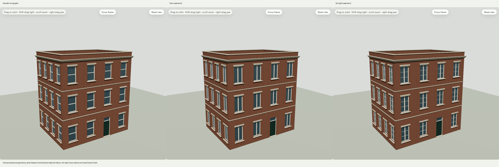
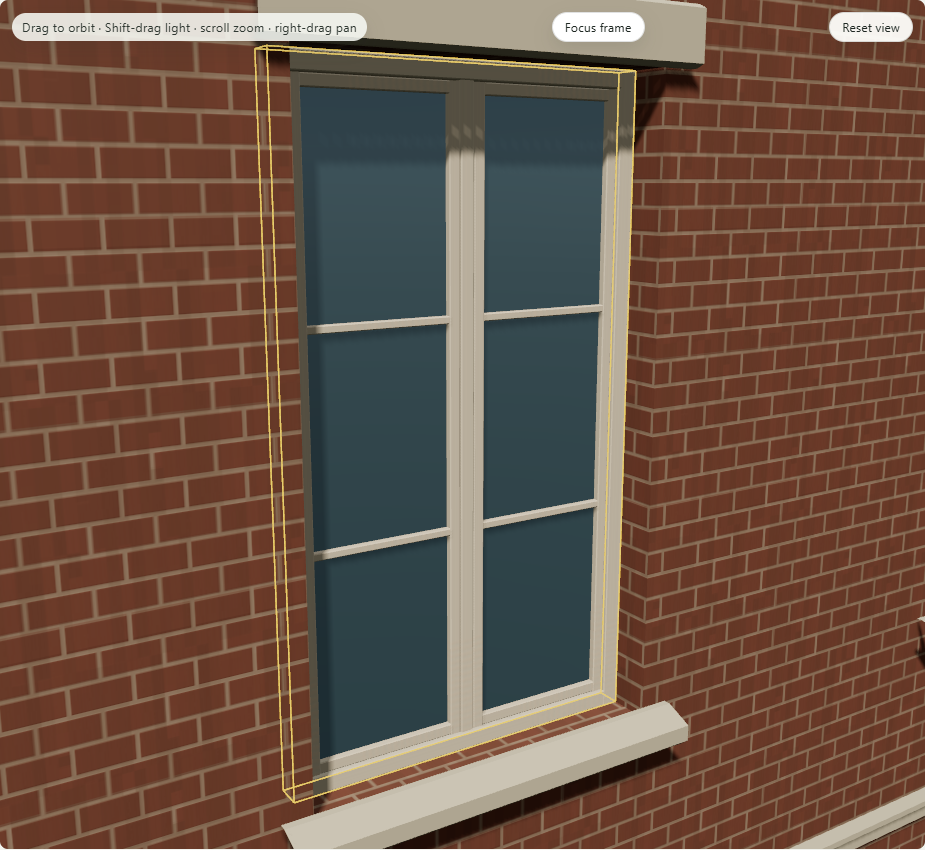

# C7 - procedural window assembly vocabulary

Engineering and rendered verification complete. The [October25 directive](../2026-10-25-vocabulary-direction/decision.json) authorizes this bounded vocabulary milestone. The original double-hung sash is joined by **Twin casement** and **Six-light casement**. All are compiler-built shared assemblies; no preassembled meshes or second renderer were added.

Use **Openings → Window assembly**, then Apply. The select describes the actual affected-window count and uses the same draft/publication/history path as the numeric controls. The named choice is also available in advanced properties after migration. A selected frame still scopes finishes; geometry is shared.

## Source, generation and materials

Choosing a new assembly explicitly migrates the current graph to0.5 and the worker protocol to0.5. Portable project0.6 wraps it with optional unchanged generation lineage. Reading old graph/project files inserts no defaults or new fields. The legacy compiler-result hash, all three existing recipe pins and original default native pixels remain exact.

The current authored graph owns the assembly exception over the unchanged pinned recipe base. **Keep edited dimensions and assemblies** or **Lock openings** retains it through generation/rerolls. Clearing both explicitly returns the recipe's double-hung default. This packet adds authored assembly vocabulary, not new seeded recipe definitions or historical architecture claims. PSG, snapshot admission, reference-material planning and unknown UTDG architecture coverage remain intact.

Structural assembly switches retain exact material channels; the local frame finish survives switching, generation, undo/redo, Save/Open and cold recovery. Infeasible glazing rejects while the accepted scene remains visible. Casement leaves, central mullion, bars and separate panes are real finite geometry with verified winding and nondegenerate metre UVs. These are closed fixed-pose assemblies; opening animations/new hardware are not implemented.

## Verification

All five documented checks pass: typecheck, lint, **1,770 tests /123 files**, production build and **eight standard browser workflows**. Seventeen tests were added. [Full receipt, source pins and logs](verification.json). The focused run passes54 tests; its earlier sandbox attempt could not load tests because a temporary-file rename was denied, and is retained separately.

Both native backends cover **18 observed states**. WebGPU has14 capture events; WebGL has15, including an extra opened-image diagnostic. Each covers actual submitted geometry/transforms, wall/door/roof and semantic stability, all material channels, local finish retention, undo/redo, infeasible-edit recovery, authored/lock retention and explicit release, advanced edits/custom topology, portable v6, room return and cold recovery. Cold provider/material-generation calls are zero; retired owners dispose. A real standalone preview additionally verifies keyboard selection, visible focus and draft-before-Apply behavior.

The first WebGL run had exact source, compiler/rendered geometry, bindings and channels but a different reopened native PNG hash. Its unobscured screenshot interior differed at one pixel by one red level. The full first after-open native PNG was not captured, so this is not a full-frame delta count. The diagnostic rerun adds actual camera/light state and an opened capture; all strict pixel assertions pass without production changes or weakened assertions. Cause of the first variance is not proven. [First-attempt evidence](webgl-first-attempt/failure.txt) is preserved.

The proof binds318 unique source paths. The inherited first WebGPU driver repeats three pin rows; the WebGL diagnostic driver removes those duplicates. Nineteen baseline source files changed and two were added; renderer and material modules remain byte-identical. No production changes occurred after final checks/native captures started. [UI verification](design-qa.md) passes; this does not supply human artist/C6/family/block acceptance.

Complete saved product JSON is deduplicated and compressed in `portable-projects.zip`; [portable manifest](portable-manifest.json) maps each backend/raw export to its content SHA and ZIP entry. Every stored entry's uncompressed SHA is checked. This preserves actual portable files without repeating large material payloads in the evidence tree.

## Try and review

Local preview: `http://127.0.0.1:5190/#document=masonry-study-ux1`. Exec session61968 owns the loopback server; [preview.json](preview.json) records its PID/script and guarded shutdown method. The Codex browser-tab opening is queued. Existing workspace files remain supported.

[Private phone gallery](https://app.notion.com/p/3fdb77d6cd4f812a9f88f1316beb9c25) now contains **103 images**: eight new C7 images and all95 prior images. [Gallery proof](notion-proof.json) confirms retained image identities and no local image URLs. The requested Buildo parent page remains unresolved; no page was moved or reparented.

The next useful vocabulary expansion is ground-floor storefront/entrance grammar, followed by separate roof/trim work. Local structural overrides remain a different contract task. No C7 commit or GitHub push was made; the previously prepared public GitHub push still awaits its own explicit disclosure confirmation.
