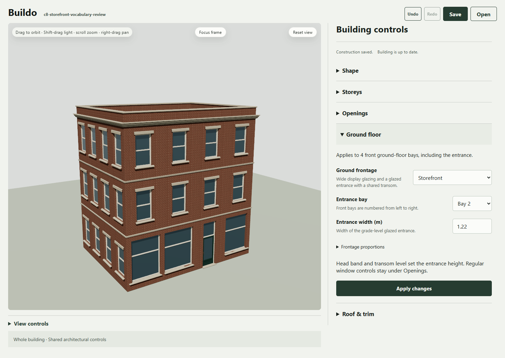
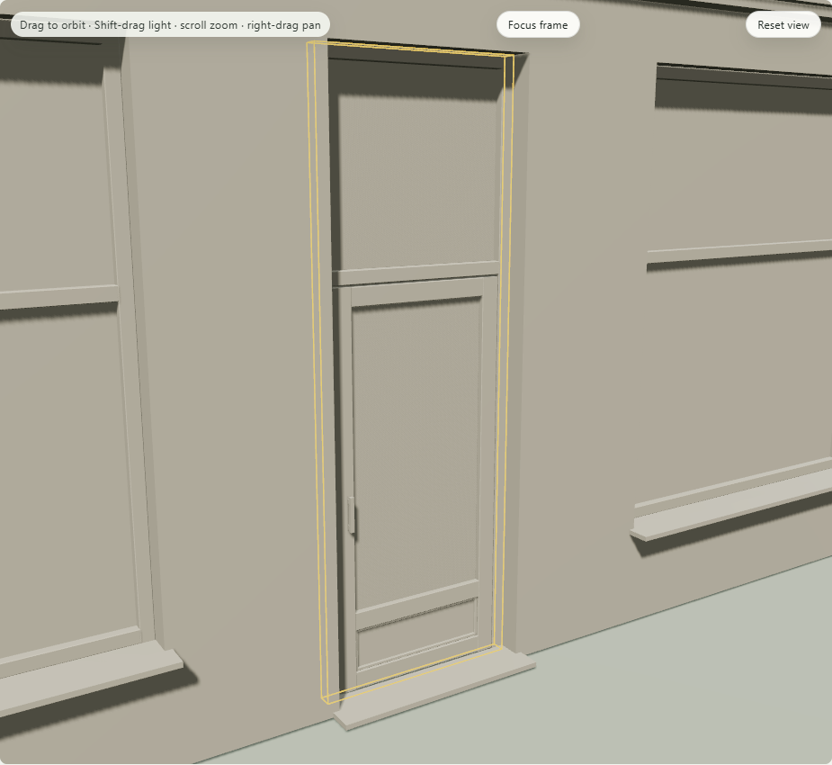

# C8.P2 - storefront authoring and continuation

The storefront vocabulary milestone is engineering complete. Use **Ground floor → Ground frontage → Storefront**, then Apply. The existing building gets wide display apertures, shared transoms and a glazed entrance. Choose the numbered entrance bay and width; Frontage proportions exposes masonry piers, bulkhead, head band, transom level, frame width and recess. Regular windows stay under Openings. The default building reports 44 regular windows and 4 front-ground bays, including the entrance.

## Source and generation

P0 supplied strict request/plan 0.1. P1 supplied graph/worker 0.6 and real compiler geometry. This packet adds portable project 0.7 and the existing grouped authoring/history/checkpoint path. Reading old files never inserts the new operator. Selecting a frontage explicitly migrates the registered topology. C7 layouts survive; changing regular windows does not replace display assemblies.

The current graph owns the authored frontage over its unchanged pinned generation recipe. Keep edited dimensions and assemblies or Lock openings retains frontage parameters, casement choice and entrance bay/width through generation. Clearing both returns the actual seeded recipe and punched frontage; the released entrance width is not hard-coded. Custom topology rejects recipe replacement while retaining the scene. Structural edits retain the material library and local display-frame finish. Explicit reference generation remains a separate material operation. UTDG architecture coverage stays unknown; no historical style or upstream compatibility evidence is invented.

The scope operator and existing geometry operators share one wall-hole authority and preserve semantic frame addresses. Closed fixed-pose frames, separate panes, glazed leaf, kick panel/beading, handle and threshold are compiler geometry. No preassembled meshes, interior model, door animation or local structural editor is added. Side/rear elevations and upper regular-window construction remain independent of ground frontage.

## Verification

All five final-source checks pass: typecheck, lint, **1,812 tests /125 files**, build and eight standard browser workflows. C8 adds 42 tests across its three sequential packets, including three product integration cases here. [Exact source, checks, receipts and negative evidence](verification.json).

Final WebGPU and WebGL each cover 20 actual App states and 17 capture events. The native observer runs the real renderer first, checks submitted compiler geometry and transforms, then captures actual canvas pixels. Tests exercise local finishes, bulkhead/entrance edits, regular casements, history, invalid-fit last-good retention, actual generation/locks/release, custom graph fallback/Undo, project v7 Save/Open, room return, resource disposal and cold recovery. Final native pixels and source are exact across reopening/room/cold continuation; cold provider and material-generation calls are zero. Renderer and material modules remain unchanged. The proof binds 338 code/config paths plus two supplemental imported JSON inputs checked against the pre-P2 commit.

Earlier failures are retained. A new test initially assumed a fixed released entrance width; the seeded recipe actually selected1.1m, and the test now compares the exact resolution. First native drivers assumed lookup insertion order and a grouped Apply button on custom graphs; those observations were corrected without changing product behavior. The phone mode label clipped, so it was shortened to Storefront and every required check reran on final source.

Two WebGL runs had one reopened native pixel differ by one channel level despite exact source/geometry/material/camera/light state. Both native frames are preserved; this is a full-frame comparison, not a screenshot crop. The expanded read-only diagnostic records material/sampler, renderer and shadow state, retains the original exact-pixel conditions and now passes reopen, room return and cold continuation. No pixel tolerance or production geometry/material repair was added. Cause of the earlier variance is not proven; final passing checks do not erase it. [First full native delta](attempts/webgl-01/full-native-reopen-delta.json).

The [uninstrumented UI check](ui-qa.json) verifies complete labels, 44px fields, 3px keyboard focus and no horizontal overflow at 1493×1054,900×1100 and430×1000 CSS sizes. The mechanical detector reports no findings. [Visual QA](design-qa.md) records manual inspection and the limits of browser-size emulation; no recruited artist or assistive-technology study is claimed.

Complete product files are deduplicated in [portable-projects.zip](portable-projects.zip). The [manifest](portable-manifest.json) preserves 25 backend/attempt aliases to 3 literal files, including old C7 and final C8 sources. Every uncompressed entry SHA is verified; raw local exports and attempts remain untouched.

## Review and publication

[Phone gallery](https://app.notion.com/p/3fdb77d6cd4f812a9f88f1316beb9c25): nine new reviewed C8 images, 112 total, all 103 prior image identities retained. Native image blocks have no local image URLs. The requested Buildo parent placement remains unresolved; no page was moved or reparented.

C8.P0 and P1 are separate local commits; this packet is prepared on codex/c8-p2-storefront-authoring. Public GitHub PR publication still awaits the exact public-payload approval after automatic approval review rejected the external push. No public push, merge, provider purchase, release or installation occurred. Human broader visual/workflow/family/block/performance review remains separate from these engineering results.
