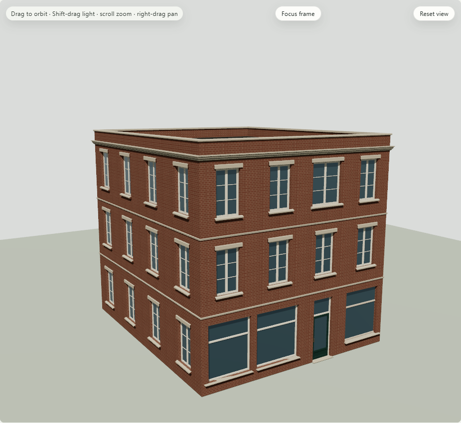
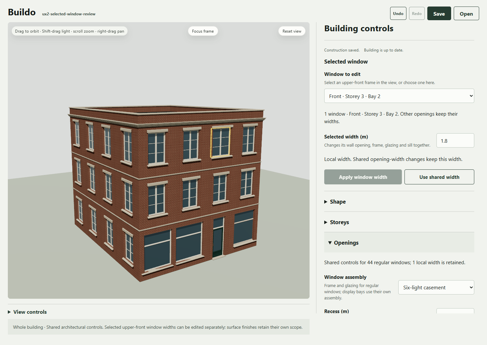
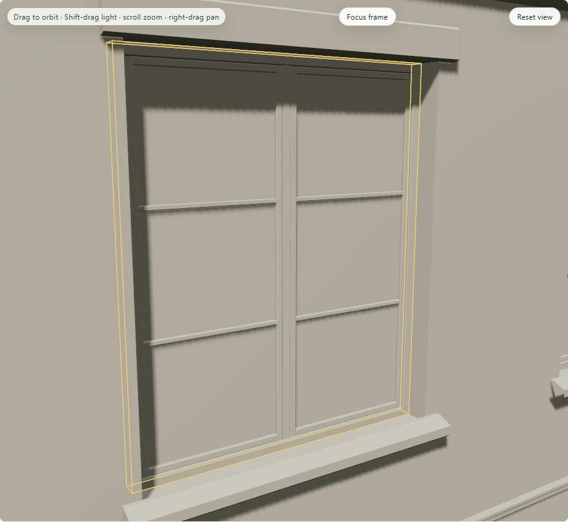

# UX2.P2 - selected-window authoring and continuation

Engineering complete. Choose an upper-front frame in the viewport or **Selected window → Window to edit**, set **Selected width (m)** and choose **Apply window width**. The same structural target changes its real wall hole, frame, glazing and sill. Other openings stay unchanged. **Use shared width** resets one override to the current shared opening width. Shared controls disclose retained local widths.

## Ownership and source

The accepted fixture supplies eligible semantic frame addresses and real scope labels. Selection callbacks from retired fixtures are ignored; dropdown selection drives the same viewport highlight. Unapplied local width text does not enter graph/history. It blocks Save, generation and shared publication until applied or reverted; changing targets discards that uncommitted scratch width rather than applying it to another window. Invalid fits keep the accepted scene and source. Advanced nodes remain available, with the actual local override list visible.

Graph/worker0.7 is unchanged from P1; this packet admits portable project0.8 explicitly. Old project reads insert nothing. Existing history/checkpoint ownership and pinned generation/reference lineage remain intact. Keep edited dimensions and assemblies or Lock openings retains local width overrides through generation. Clearing both releases them to the actual seeded recipe. Missing preserved targets reject rather than redirect. Structural switches preserve material artifacts and local finishes.

A local finish on a removed window has an independent existing guard: “Surface layer has no current semantic target.” The candidate is rejected with accepted source unchanged. Native proof explicitly removes that finish, reapplies supported generation controls and removes the storey; reopening restores the saved width and finish exactly. No finish is silently discarded. Generation controls refresh from accepted lineage after a graph publication, so the driver reasserts its intended release inputs after finish removal.

The first scoped operation supports upper-front regular windows only. Ground storefront/door widths, side/rear windows and other local dimensions remain separate tasks. UTDG material/reference lineage stays pinned; historical architecture coverage remains unknown. This adds no preassembled meshes, second generator, renderer repair or new material source.

## Verification

All five final-source checks pass: typecheck, lint, **1,860 tests /128 files**, build and **eight standard E2E workflows**. Four new product cases cover eligible options/scratch ownership, bypassed targets, real Apply/reset/invalid fit/history/portable/checkpoint behavior and generation retention/release/target loss. [Required check receipt](required-checks.json) and [verification](verification.json).

Each actual WebGPU/WebGL run passes **19 observed states /16 captures**, with zero page/console errors. The passive observer executes the real renderer first, then compares submitted geometry and transforms against compiler buffers. It checks one-window causality, unaffected geometry, material channels and binding retention, local finish, shared-width interaction, Undo/Redo/reset, legal missing-target rejection, explicit finish-removal recovery, generation/locks/release, custom topology and owner disposal. Final native pixels match exactly after reopening, room return and cold recovery on each backend; cold provider/material-generation calls are zero. Final portable files are literal-equal across backends.

The [uninstrumented UI probe](ui-qa.json) passes desktop1493×1054, tablet900×1100 and compact430×1000: complete visible control text,44px fields,3px keyboard focus and no horizontal overflow. [Visual review](design-qa.md) inspects actual whole/close/clay, desktop/tablet/phone and WebGL cold images. The mechanical detector reports no findings. No real iOS/Safari, assistive-technology or recruited-artist study is claimed.

All346 code/config pins remain stable throughout final checks and captures. Of344 prior paths,332 are literal-unchanged,12 existing source/test/CSS paths changed and two were added. Material and renderer modules are unchanged. [Source pins](source-pins.json), [preservation](preservation.json), exact changed-source snapshots and the sealed inventory bind the result. [Portable manifest](portable-manifest.json) maps16 aliases to four literal files in [portable-projects.zip](portable-projects.zip).

## Negative evidence and limits

Native attempt1 requested one storey, below the existing UI minimum2; browser validation correctly prevented submission. Attempt2 reached the existing orphan-finish guard while expecting target removal to succeed. A separate [diagnostic](attempts/release-diagnostic-webgpu/diagnostic.json) proves accepted source retention and the exact error. Attempt3 did not reassert release controls after publishing finish removal refreshed them from accepted lineage; it correctly retained the override. The final driver respects these product states and keeps all strict source/geometry/material/pixel assertions. Production source did not change between these attempts and final passing captures. Failed logs, screenshots and partial receipts remain under attempts; complete raw attempts remain local.

The selected edited trim uses P1's closed loft; other accepted legacy trim retains its previous cap fan. WebGL retains existing shadow-map fallback and shader precision warnings and visible material/trim differences from WebGPU. This verifies within-backend continuation, not cross-backend visual parity or a global legacy trim repair. The earlier C8 one-pixel variance remains historical evidence; these final P2 runs pass strict equality without pixel tolerance.

## Review and publication

[Phone gallery](https://app.notion.com/p/3fdb77d6cd4f812a9f88f1316beb9c25). Eight inspected runtime images are prepared for a bounded append using immutable public GitHub image URLs after this packet is published. Its112 existing images will be retained; the publication receipt will record the actual update. Direct-upload credential persistence and the in-memory terminal route were rejected by automatic approval review; no credentials were saved or uploaded through that route. Public image sources avoid those credentials entirely. Buildo parent placement remains unresolved; no page was moved.

P0 is [PR #6](https://github.com/atxbrianbehm/buildo/pull/6); P1 is [PR #7](https://github.com/atxbrianbehm/buildo/pull/7). This P2 branch is stacked on P1; merging remains with the user. The next plan gate is human review of this actual selected-window task before further scoped operations or broad UI migration. C6 and the earlier grouped direction were accepted separately; they do not automatically accept this new task.
